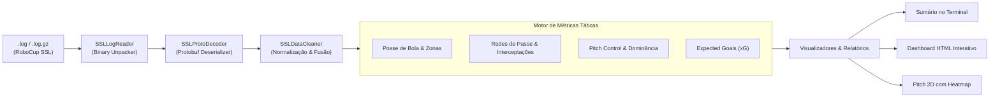

## ⚽ Visão Geral

Este sistema computacional foi desenvolvido para a **Small Size League (SSL)** da RoboCup. Ele ingere fluxos de dados brutos e serializados gerados por simuladores (*grSim*, *ssl-simulation*) e pelo sistema de visão oficial (*SSL-Vision*), realiza a limpeza e normalização espaço-temporal dos dados e extrai métricas táticas quantitativas em tempo real ou no pós-jogo.

O objetivo principal é fornecer à equipe de robótica da UDESC diagnósticos científicos objetivos para mensurar, auditar e aprimorar a tomada de decisão da inteligência artificial (baseada em regras ou em **Aprendizado por Reforço - RL**).

---

## 🛠️ Arquitetura do Software



### Módulos Principais:
1. `proto/`: Especificações oficiais Protocol Buffers da SSL (`messages_robocup_ssl_detection.proto`, `messages_robocup_ssl_geometry.proto`, `messages_robocup_ssl_wrapper.proto`, `ssl_referee.proto`).
2. `src/parser/`:
   - `binary_reader.py`: Leitor e gravador de alta performance para arquivos binários `.log` e compactados `.log.gz`.
   - `proto_decoder.py`: Deserializador dos pacotes de visão (`SSL_WrapperPacket`) e árbitro eletrônico (`SSL_Referee`).
   - `cleaner.py`: Fusão de câmeras, interpolação temporal de quadros a 60 Hz e conversão de coordenadas para metros.
3. `src/metrics/`:
   - `possession.py`: Cálculo de posse individual e coletiva, disputas de bola, turnovers e ocupação por terço do campo (defesa, meio, ataque).
   - `passing.py`: Detecção automática de chutes e passes, cálculo de distância, acurácia e matriz de adjacência (rede de passes).
   - `pitch_control.py`: Superfície contínua de dominância espacial (modelo físico de Spearman / Fernandez-Bornn vetorizado com NumPy) e métricas de compactação defensiva.
   - `xg.py`: Modelo de Expected Goals adaptado para robôs SSL com base no ângulo visível do gol, distância e obstrução de defensores.
4. `src/visualizer/`:
   - `pitch_2d.py`: Renderizador do campo de futebol 2D oficial (Divisão A e B) com robôs, orientações e trajetórias da bola.
   - `report.py`: Gerador de relatórios executivos em texto plano e relatórios web completos em HTML.

---

## 🚀 Instalação e Uso

### 1. Clonar o Repositório e Configurar Ambiente
```bash
git clone <url-do-repositorio>
cd "Sistema de Análise de Dados e Avaliação Tática para a Competição SSL"

# Instalar dependências
pip install -r requirements.txt
```

### 2. Gerar Dados de Partida Simulada (Fixture)
Para testar o pipeline sem precisar de uma partida física gravada, utilize o gerador de partidas sintéticas:
```bash
python3 scripts/generate_synthetic_log.py
```
Isso criará uma partida simulada em `data/sample_matches/synthetic_match.log.gz`.

### 3. Gravar Partida ao Vivo via Rede (Multicast UDP)
Quando estiver jogando uma partida no laboratório (no `grSim` ou com os robôs reais e *SSL-Vision*):
```bash
# Gravar a partida em tempo real (salva automaticamente com data e hora):
python3 -m src.recorder

# Ou especificando o nome do arquivo:
python3 -m src.recorder --output data/raw/minha_partida.log.gz
```
O gravador mostrará o status em tempo real (tempo decorrido, taxa de quadros/fps da visão e mensagens do juiz). Ao terminar a partida, basta pressionar **Ctrl + C** e o arquivo estará pronto para ser analisado.

### 4. Dashboard Web Interativo e Player 2D da Partida
Para abrir o painel visual interativo com reprodução 2D do campo em tempo real:
```bash
python3 -m src.web.server
```
Em seguida, abra o navegador em: **`http://localhost:8080`**

Recursos do Dashboard Web:
* **Seletor de Partidas:** Carrega qualquer arquivo `.log.gz` salvo em `data/raw/` automaticamente.
* **Player 2D do Campo:** Play/Pause, controle de velocidade (0.5x, 1x, 2x, 4x), barra de timeline (*slider*) e rastro dos robôs e da bola.
* **Timeline de Eventos Interativa:** Pílulas com chutes (xG), defesas do goleiro, passes e desarmes; clicando em qualquer evento o replay salta direto para aquele lance!
* **Ficha dos Atletas-Robôs:** Tabela com métricas físicas e técnicas por robô individual.

### 5. Executar a Análise Tática via CLI
```bash
python3 -m src.cli --log data/sample_matches/synthetic_match.log.gz --output-dir output/
```

O comando irá:
1. Processar todos os frames binários do jogo;
2. Exibir o sumário tático completo no terminal;
3. Gerar um relatório interativo em HTML em `output/relatorio_tatico.html`;
4. Gerar a imagem 2D com mapa de calor de Pitch Control em `output/pitch_overview.png`.

### 4. Executar os Testes Automatizados
```bash
python3 -m unittest discover tests -v
```

---

## 📊 Exemplo de Saída do Relatório Tático

```text
======================================================================
          RELATÓRIO TÁTICO PÓS-JOGO - ROBOCUP SSL
          UDESC Robotics (Amarelo) vs ER-Force (Azul)
======================================================================
Duração Total Analisada: 10.0 s
----------------------------------------------------------------------
MÉTRICA                             | UDESC Robotics  |    ER-Force    
----------------------------------------------------------------------
Posse de Bola (Tempo)               |           5.7s |           0.0s
Posse de Bola (%)                   |          100.0% |            0.0%
  - Terço Defensivo                 |           1.0s |           0.0s
  - Terço Central                   |           3.5s |           0.0s
  - Terço Ofensivo                  |           1.1s |           0.0s
Perdas de Posse (Turnovers)         |               0 |               0
----------------------------------------------------------------------
Passes Totais                       |               3 |               0
Passes Certos                       |               2 |               0
Acurácia de Passe (%)               |           66.7% |            0.0%
Passes Interceptados                |               0 |               0
----------------------------------------------------------------------
Finalizações (Chutes)               |               2 |               0
Expected Goals (xG Total)           |            0.35 |            0.00
======================================================================
Domínio Espacial Médio (Pitch Ctrl) |           57.7% |           42.3%
Compactação Média (Raio Spread)     |          0.99m |          0.41m
======================================================================
```

---